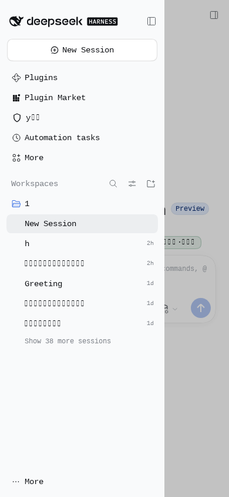
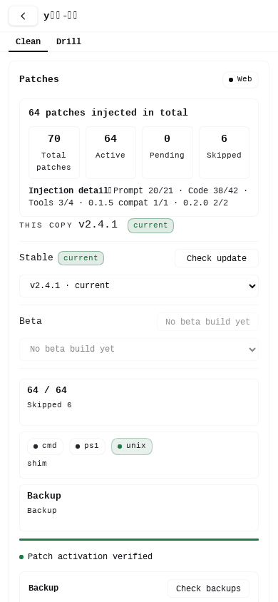
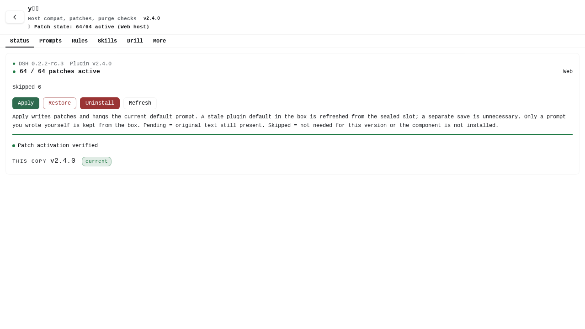
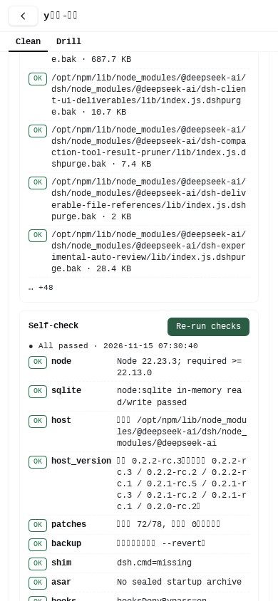

# dsh-purge · y执行面板

一个面向 DeepSeek Harness（DSH）的增强插件：为智能体解除预设限制（开放模式），并提供一个整页式的「y面板」控制台，把补丁注入、提示词覆盖、规则与技能管理、备份与自检全部收进一个入口。

> 仅供自有环境、授权测试与安全研究使用，请遵守所在平台的服务条款与当地法律法规。

## 界面预览

侧栏入口（盾形图标，位于插件市场与自动化任务之间）：



整页面板（移动端，状态总览 + 注入总计卡）：



桌面端整页面板：



备份盘点与自检：



## 功能特性

### 开放模式
- 解除智能体的预设限制：工具调用、文件写入、网络访问与终端执行不再受预设约束
- 首页提供状态徽标：绿色=已启用，灰色=未启用，一目了然

### y面板（整页控制台）
- 从左侧栏盾形图标进入，整页展示、无弹窗遮挡
- 六个页签：状态 / 提示词 / 规则 / 技能 / 演练台 / 更多
- 移动端与桌面端均已适配

### 补丁注入总览
- 「总计卡」展示：注入总数、已生效、待应用、跳过 四项计数
- 注入明细按层拆分：提示词层 / 代码补丁 / 工具层 / 兼容层
- 当前副本与版本通道（Stable / Beta）选择、检查更新

### 备份检测
- 自动盘点所有补丁备份文件（`.dshpurge.bak`）与 shim 备份目录
- 汇总文件数量、总体积，并标记缺失 / 空文件等异常项
- 支持一键还原（`--revert`），升级翻车可随时回退

### 自检（可反复重测）
- 覆盖 node / sqlite / 宿主目录 / 宿主版本兼容 / 补丁状态 / 备份 / shim / asar / hooks 等检查项
- 每次运行都会刷新检测时间戳，方便升级后确认环境状态

### 提示词覆盖编辑器
- 直接在面板中编辑生效提示词，支持保存覆盖与还原默认
- 密文存储，不落明文

### 可写性预检（容器友好）
- 打补丁前先真实试写目标目录，区分「只读文件系统（EROFS）」与「权限不足（EACCES）」
- 报错附带具体路径、errno、进程 uid 与目录属主
- 识别容器环境并给出对应修法（如取消 `read_only`、`chown` 目录属主），不再误报「版本不匹配」
- Docker 部署（如 1Panel 应用商店版）也能顺利打上补丁

### 演练台
- 内置红队演练台页签，与资产库、得分链路联动
- 支持授权范围内的渗透测试流程记录与成果管理

## 安装

方式一：在 DSH 插件市场搜索安装。

方式二：使用发布包手动安装：

```bash
cd ~/.dsh/profiles/web
npm install /path/to/dsh-purge-<版本>.tgz
```

安装后重启 DSH web 服务生效：

```bash
systemctl --user restart dsh-web   # 或你的实际重启方式
```

## 使用

1. 打开 DSH 网页端，左侧栏点击 **y面板**（盾形图标）
2. 首次进入按页面引导完成初始化
3. 在「状态」页签执行 **应用**，补丁与提示词注入即刻生效
4. 首页徽标变绿即表示开放模式已启用

## 兼容性

- 持续适配 DeepSeek Harness 官方新版本（覆盖 0.2.x 系列）
- 支持 Linux / macOS / Windows(WSL) 与 Docker 容器部署
- Web、桌面端宿主均可使用

## 目录结构

```
dsh-purge/
├── client.js              # 前端：y面板、徽标、侧栏注入
├── lib/
│   ├── index.js           # 服务端入口与路由
│   ├── core.js            # 补丁引擎、可写性预检
│   ├── redteam/           # 演练台集成
│   └── doctor.js          # 自检逻辑
├── presets/redteam/       # 开放模式预设
├── skills/redteam/        # 红队技能集
└── bin/dsh-purge.js       # 命令行工具（--apply / --doctor / --revert）
```

## 命令行

```bash
node bin/dsh-purge.js --apply    # 应用全部补丁与注入
node bin/dsh-purge.js --doctor   # 运行自检
node bin/dsh-purge.js --revert   # 还原备份
```
